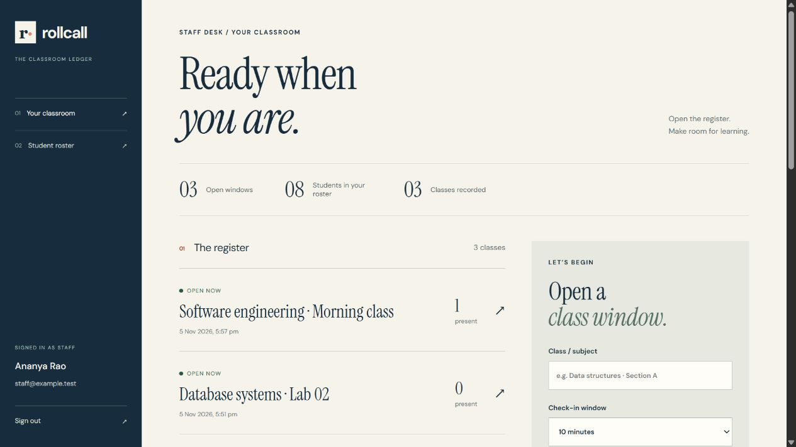

# Rollcall

A SvelteKit attendance application for a teacher and their student roster. Open a timed register, share a short-lived check-in code, confirm students in person and export a clear attendance record.

The active application uses **Svelte 5, SvelteKit 3, Node.js and SQLite**. WAMP, PHP and MySQL are no longer required. The previous implementation is retained under [`legacy/wamp`](legacy/wamp) for reference, outside the application’s served files.



## Run locally

Install **Node.js 24 LTS** and Git. Node 22.17+ is supported by the declared engine; Node 24 is the tested version. SQLite is built into Node, so no separate database service is needed. Some supported Node versions print an experimental SQLite notice.

```sh
git clone https://github.com/BroCoder007/attendance.git
cd attendance
npm ci
npm run setup
npm run account -- teacher teacher@example.edu "Your full name"
npm run dev
```

The account command asks for a password without displaying it. Use 12–128 characters. Open **http://127.0.0.1:5173** and sign in. Add students from **Your people → Add a student**. There is no public registration and no default production account.

For automation, the account command also accepts `ACCOUNT_PASSWORD` in the environment. Keep it out of shell history, logs and committed files; unset it after use. Reset a staff password from the server terminal with `npm run account -- reset teacher@example.edu`.

See [the isolated demo](docs/DEMO.md) to explore synthetic data without touching your real database.

## Everyday workflow

1. **Prepare the roster.** Add a name, unique roll number and individual initial password. Share credentials privately. Staff can reset a password or pause an account; either action revokes existing login sessions. Pausing keeps historical attendance.
2. **Open attendance.** Name the class and choose a window. An optional IPv4/IPv6 CIDR limits student self-check-in to a network.
3. **Display the code.** Codes last two minutes. Select **New code** when needed; codes do not renew automatically. Students sign in and enter the code for an open class belonging to their teacher.
4. **Confirm in person.** Select a student manually or scan their signed, two-minute QR pass. Camera scanning uses `BarcodeDetector` where supported, with QR-text and manual-selection fallbacks. Camera access needs HTTPS or localhost. The QR is recorded only after staff select **Mark present**.
5. **Review and export.** Class attendance refreshes every 15 seconds while the page is visible. Close a window early if needed; expiry also stops check-in. CSV includes the current active roster plus students with a saved check-in, with UTC timestamps and spreadsheet-formula protection.

Student pages show only that student’s open classes and latest 100 check-ins. Code/network checks support attendance collection; they cannot establish physical presence or stop credential sharing. Staff should verify attendance when that matters.

## Configuration

`npm run setup` creates an ignored `.env` without replacing an existing one. See [`.env.example`](.env.example).

| Setting | Purpose |
| --- | --- |
| `AUTH_SECRET` | At least 32 random characters; signs QR passes. Setup generates 32 random bytes. Keep private and consistent across restarts. |
| `DB_PATH` | Persistent SQLite file; default `data/rollcall.sqlite`, relative to the working directory. |
| `ORIGIN` | Exact external origin, read into SvelteKit 3’s `paths.origin` **at build time**. Rebuild after changing it. Local setup uses `http://127.0.0.1:5173`; production must use your HTTPS origin. |
| `PUBLIC_TIME_ZONE` | Valid IANA timezone for the interface, e.g. `Asia/Kolkata`. Defaults to UTC. CSV always uses UTC. |
| `HOST`, `PORT` | Production server binding, e.g. `127.0.0.1` and `3000`. |

## Build and deploy

Before building, set `.env` to your actual HTTPS deployment origin, private signing key, persistent database path and timezone. `ORIGIN` is compiled into the build; changing it only when starting the server will not update the build.

```sh
npm test
npm run build
npm start
```

Deploy the generated `build/`, `package.json`, lockfile and installed production dependencies, or build on the server. Run from the project directory behind an HTTPS reverse proxy. This is a server application: **GitHub Pages/static hosting and copying files into a WAMP web root will not run it.**

Use one Node instance and a persistent local disk. SQLite suits a modest classroom deployment; this version is not designed for horizontally scaled servers, ephemeral serverless disks or a network-mounted database. It uses prepared statements, WAL mode, a busy timeout and a unique `(room_id, student_id)` attendance key.

Phones need a classroom-network address or an HTTPS hostname that can reach the server. Development intentionally binds to loopback. For a deliberate LAN test use `npm run dev -- --host 0.0.0.0`, set `ORIGIN` to the exact LAN origin and permit the port through the firewall. HTTP over LAN does not enable camera access in most browsers.

### Addresses behind a proxy

The app uses SvelteKit’s `getClientAddress()` rather than directly trusting arbitrary `X-Forwarded-For` values. A reverse proxy otherwise appears as the client. Configure adapter-node’s `ADDRESS_HEADER` and `XFF_DEPTH` only when a trusted proxy overwrites that header, the Node port cannot be reached directly and the hop count is known. Wrong settings undermine network restrictions and rate limits. Public internet connections usually expose a public/NAT address, not the student’s private Wi-Fi address.

### Backups

Keep `data/` and `.env` outside public/static directories, restrict filesystem access and use encrypted backups appropriate to student records. Stop the application before copying the database, including any `-wal` and `-shm` files; alternatively use SQLite’s online backup tooling. Test restoring a backup. Rotating `AUTH_SECRET` invalidates QR passes, not login sessions; clear the `logins` table during a maintenance window if all sessions must be revoked.

## Migration

Read [MIGRATION.md](docs/MIGRATION.md) before switching a live installation. This app initializes a **new SQLite schema**; it does not automatically import or overwrite MySQL records. Old students never had passwords and need new accounts. Do not serve the archived PHP application publicly.

## Checks

```sh
npm test                 # Isolated domain/security regression tests
npm run build            # Production client and server build
npm run test:http        # Build first; HTTP tests with an isolated temporary DB
```

Tests cover password verification, session expiry/revocation, rate limits, IPv4/IPv6 networks, teacher ownership, scoped check-in, code expiry, duplicate protection, closed windows, QR validation and CSV escaping. HTTP tests exercise the real server, CSRF rejection and role/report access. CI runs the checks on Node 24. Camera hardware and your real proxy/network configuration require deployment testing.

## Design and scope

The paper-and-ink ledger uses editorial type, restrained colour and rule-based lists. The direction draws on the typography and navigation clarity of the Webby-winning [Limerick School of Art & Design](https://unthink.ie/projects/lsad/) and the [Cornell Human Ecology redesign](https://primacy.com/cornell-human-ecology). Application code and layout are original; no winning site’s assets or layout were copied. Fonts are served with the app.

This release supports one teacher-owned roster per student account. It does not include school-wide administration, multiple-course enrolment, historical roster snapshots, password-reset email, offline check-in or biometrics. Reports distinguish “not recorded” from a verified absence; the current roster is not a historical enrolment snapshot.

See [SECURITY.md](SECURITY.md) for the security model.

## GitHub Pages preview

The [public preview](https://brocoder007.github.io/attendance/) is a static showcase with synthetic data. Real sign-in, check-ins and saved attendance require the Node.js application and persistent SQLite storage described above. The preview source is in `docs/pages/`.
